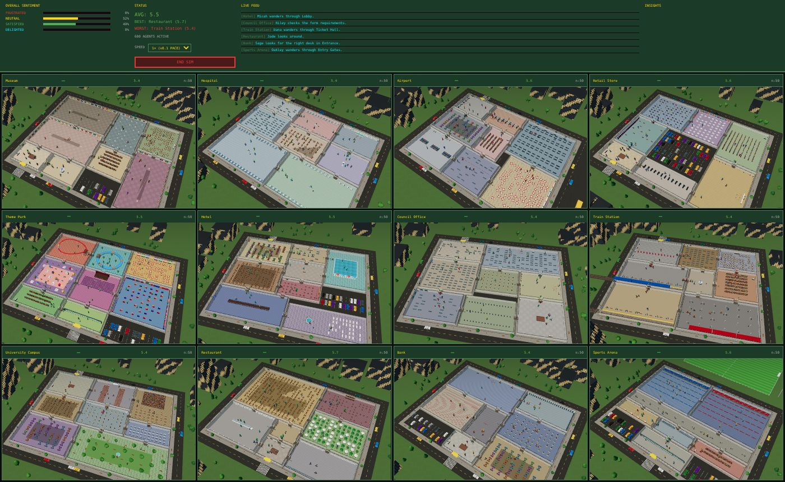
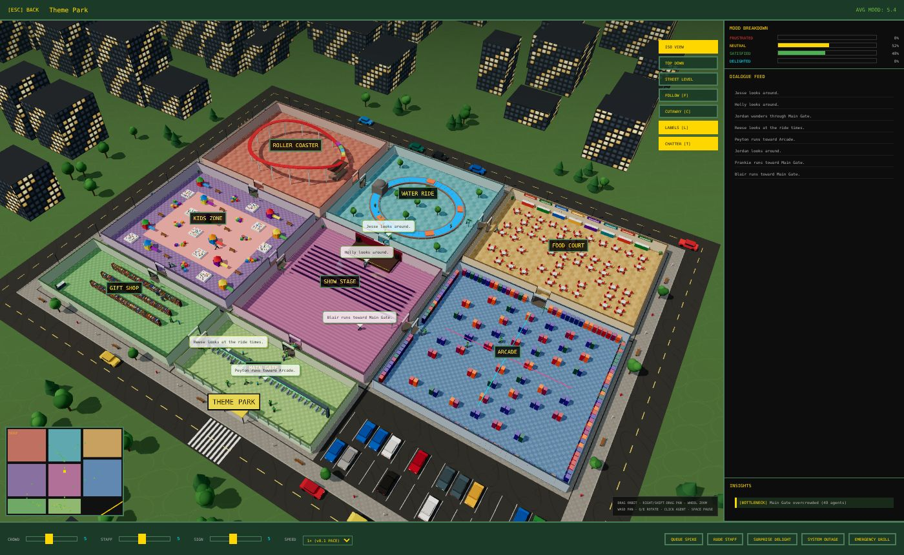
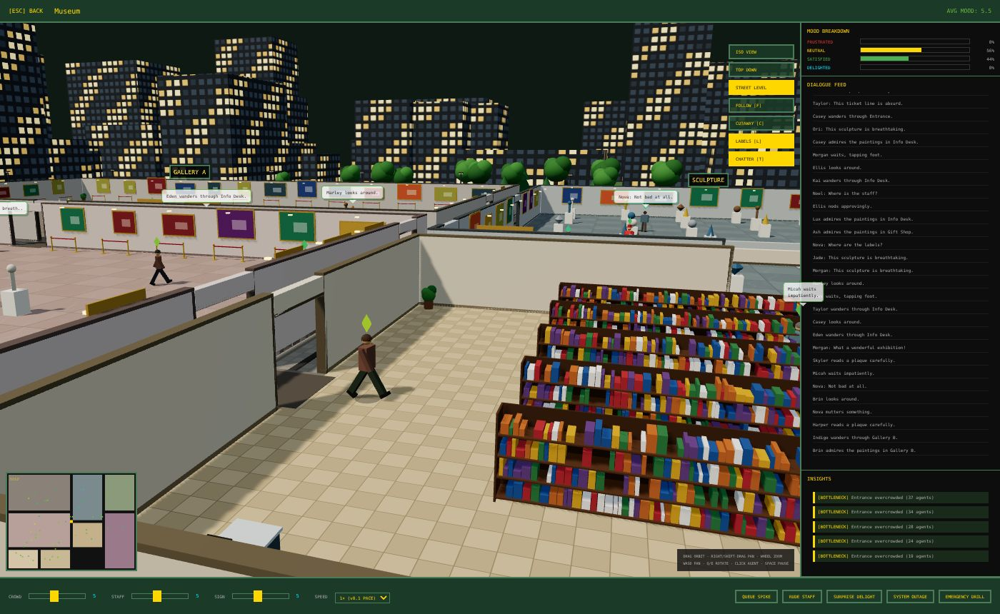

# Service Safari 3D — v0.3

The 12-venue live service simulation from [ServiceSafariSimV0.1](https://github.com/ram1729/ServiceSafariSimV0.1), rebuilt as a true 3D simulation. The simulation itself — visitor archetypes, states, the mood model, crowd pressure, mood contagion, events, insights and the final report — is carried over from v0.1. What changed is the world those agents live in: every venue is now a furnished 3D building and every agent is an animated 3D person.



## Run it

```bash
npm install
npm start          # http-server on http://localhost:8080
```

Any static web server works (the app uses ES modules, so it must be served over HTTP rather than opened as a file). Three.js r186 is vendored in `vendor/`, so no CDN or build step is needed. The only external request is the Press Start 2P font from Google Fonts (falls back to monospace offline).

## What's the same as v0.1

- **Screens and flow:** start screen (agents per venue, crowd / staff / signage, venue assignments) → 12-cell live grid with dashboard, live feed and insights → venue detail with mood breakdown, dialogue feed, insights, sliders and event buttons → simulation report.
- **Simulation core:** the 12 venues, their zones, archetypes, needs and dialogue; the eight agent states; mood drift, crowding, contagion, staff/signage effects; the five events; the four insight types (bottleneck, friction, cascade, divergence); the report's rankings and recommendations. Tick rate is still 100 ms.

## What's new in 3D

**Venues as buildings.** Each zone is a building with a textured floor (tile, wood, carpet, concrete, polished stone, paving — the same floor vocabulary as v0.1), walls, door frames and a doorway wherever two zones share a wall. The block sits on paved plazas inside a perimeter street with traffic, parked cars, lamps, benches and trees, with a lit skyline beyond.

**Rooms are fitted out for what they are**, across more than 50 zone types: galleries with paintings and sculpture plinths, wards with beds, IV stands and monitors, check-in desks and security scanners, baggage carousels with moving bags, stadium stands facing a floodlit pitch, platforms where trains arrive and depart, a roller coaster and water ride with moving cars and boats, a show stage with sweeping spotlights, a pool with rippling water, lecture theatres, libraries, bank vaults, kitchens, arcades and more. Airport, train station, theme park and sports arena each get a landmark outside (aircraft, rail line, Ferris wheel, pitch).

**Agents as people.** Low-poly humanoids rendered with GPU instancing (2,400 at once in the grid). Shirt colour, hat and bag still identify the archetype, as in v0.1; skin, hair, height and trousers vary per person. Legs and arms swing with walking speed, people face where they're going, frustrated agents throw their arms up, delighted ones hop, and a spinning mood gem (v0.1's mood colours) floats over every head. Agents now walk through doorways rather than through walls.

**Sliders and events you can see.** Staff behind counters and desks appear in proportion to STAFF RATIO, and wayfinding signs at doorways appear in proportion to SIGNAGE QUALITY. RUDE STAFF turns the staff red, SYSTEM OUTAGE dims and flickers the lights and screens, EMERGENCY DRILL fires red beacons, SURPRISE DELIGHT drops confetti, and QUEUE SPIKE pulses rings over the service zones.

**Cameras.** In the venue view: drag to orbit, right-drag or shift-drag to pan, wheel to zoom (toward the cursor), WASD/arrows to pan, Q/E to rotate. Presets: ISO (1), TOP DOWN (2), STREET LEVEL (3), plus FOLLOW (F), a chase camera on the selected agent. CUTAWAY (C) lowers the walls, LABELS (L) toggles room names, CHATTER (T) shows speech bubbles over agents who just spoke. Click an agent for their card (as in v0.1); the minimap still shows the camera's footprint and can be clicked to jump.

**Speed control.** `1×` is v0.1's pace. At that pace agents cover about 1.5 m per tick, which is a 10× time-lapse in a world measured in metres, so `½×`, `¼×` and `⅒× REAL-TIME` slow the tick rate down for watching people walk at human speed. Positions are interpolated between ticks at every speed. SPACE pauses.




## Deliberate differences from v0.1

Making the space physical forced a few small changes, all spatial:

1. **Doorway routing for every venue.** v0.1 only routed agents through doors once a venue's detail view had been opened; until then agents walked straight through walls. v0.3 routes every agent through doorways all the time, crossing each doorway straight on.
2. **No doorways at corners.** Zones that only touch at a corner no longer get a doorway, since no wall exists there to hold one. Every room is still reachable.
3. **Overlapping footprints resolved.** Five venues had zones whose rectangles overlapped, which can't be built as walls. Sizes were trimmed (airport Duty Free, hotel Bar, university Computer Lab, bank Entrance) and the sports arena now runs Sections → Concourse → Concessions / Restrooms / Merch → Entry Gates. The changes are listed at the top of `src/data.js`.
4. **Initial scatter inside rooms** rather than anywhere on the map, including the roads.

Doorways concentrate people, so average mood runs slightly lower than v0.1 in tightly connected venues. `tests/compare_v01.mjs` measures this directly against v0.1's own code (100 agents, 6 runs × 1,200 ticks):

| venue | v0.1 | v0.3 | | venue | v0.1 | v0.3 |
|---|---|---|---|---|---|---|
| Museum | 6.44 | 6.28 | | Council | 6.71 | 6.57 |
| Hospital | 5.62 | 5.64 | | Train Station | 5.82 | 5.89 |
| Airport | 5.99 | 5.96 | | University | 6.51 | 6.29 |
| Retail | 6.46 | 6.15 | | Restaurant | 5.53 | 5.37 |
| Theme Park | 6.39 | 6.32 | | Bank | 6.20 | 6.14 |
| Hotel | 6.04 | 5.85 | | Sports Arena | 5.76 | 5.37 |

## Project layout

```
index.html            screens (same structure as v0.1) + import map
css/style.css         v0.1 styles + 3D additions
src/config.js         sim constants (unchanged) + map→metre scale
src/data.js           venues, archetypes, dialogue (v0.1 data)
src/util.js           helpers, mood colours, archetype looks
src/layout.js         rooms, doorways, room graph (DOM-free)
src/sim.js            Agent + VenueSim (DOM-free; v0.1 behaviour)
src/geo.js            merges thousands of primitives into a few meshes
src/textures.js       procedural floor / ground / window / label textures
src/furniture.js      3D fit-out per zone type + animated set pieces
src/world.js          builds a venue scene: buildings, street, skyline, staff, signs, event FX
src/agents3d.js       instanced, animated 3D agents
src/camera.js         orbit / pan / zoom / follow camera rig
src/app.js            screens, grid + detail rendering, dashboard, report
vendor/               three.js r186 (MIT)
tests/                headless checks
```

## Tests

```bash
npm test                                              # sim core: all venues, events, agents stay on walkable floor
node tests/compare_v01.mjs ../ServiceSafariSimV0.1/index.html   # v0.1 vs v0.3 outcomes
python3 tests/visual_check.py http://localhost:8080 shots 0 4   # Playwright screenshots of every screen
```
